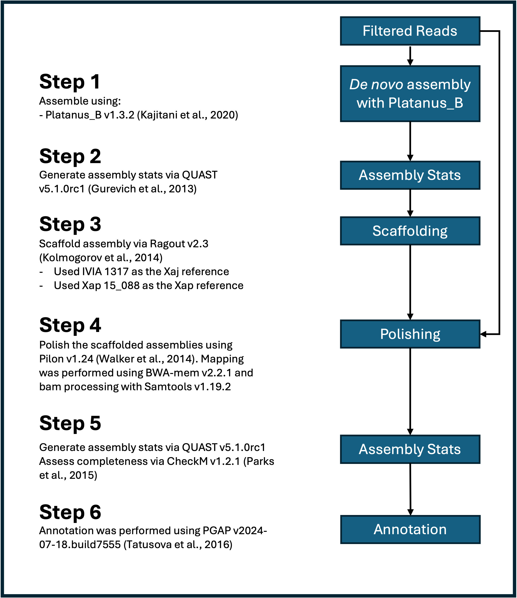
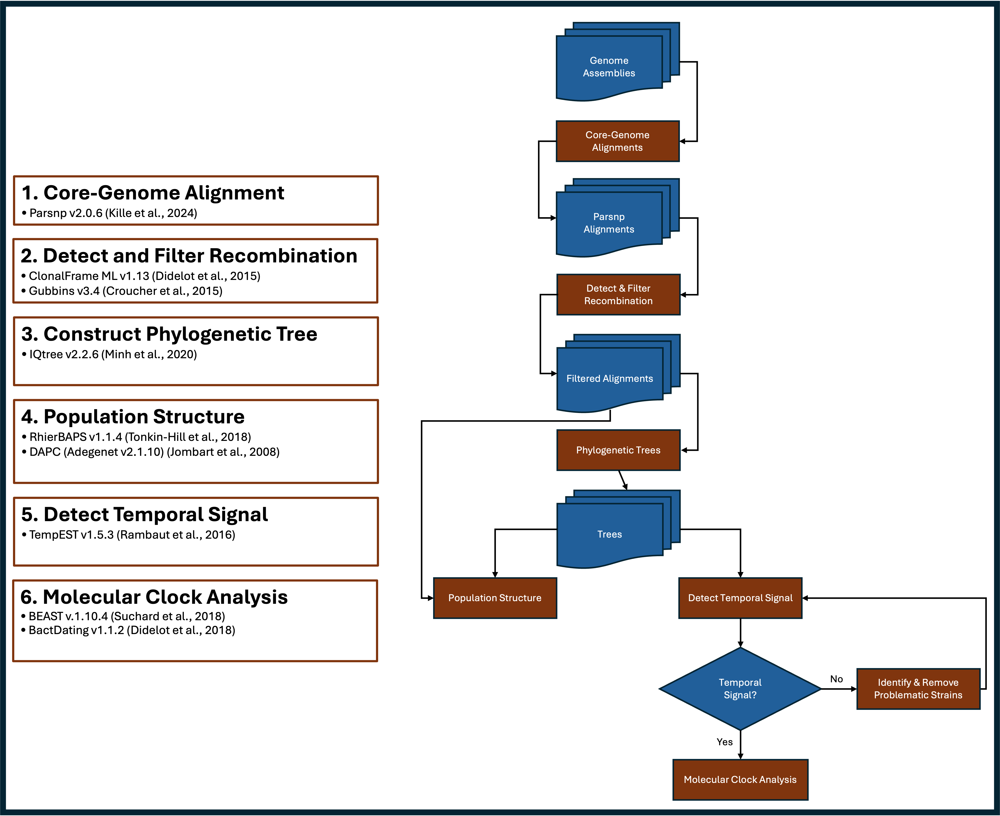

# Methods {#methods}

## Read Processing

Whole-genome sequencing from Novogene generated high-quality reads (Table \@ref(tab:SeqRes)). Novogene provides reads that have been filtered based on the following criteria:

(1) Remove reads containing adapters.

(2) Remove reads containing N > 10% (N represents the base cannot be determined).

(3) Remove reads containing low quality (Qscore<= 5) base which is over 50% of the total base.


However, I performed an additional filtering step using FastP v0.23.4 (@chen2018). The filters I'm applying are as follows: 
```bash
-q 30 (the quality value that a base is qualified)
--detect_adapter_for_pe (automatically detect adapter sequence based on paired end reads, and remove them)
```
Since we received ~2x the amount of sequencing data than we were quoted for, I chose to filter the data for the highest quality reads (q $\geq 30$). I also opted to enable the auto-detection for adapter removal. Novogene removes most adapter sequences but < 1% of the read sets contain adapter sequences so FastP _should_ detect and remove the remainders. Please refer to [FastP.sh] (\@ref(fastp-script)) for the script.

## Genome Assembly and Annotation

Prior to settling on the pipeline detailed below, I tested several other pipelines that are detailed in `XAJ_XAP_Project.v1.md`, `AS_Progress_Report_090924.v3.pptx`, and `Assembly_Pipeline_102424.pptx`. Based on the findings from the pipeline tests, we settled on the following steps for _de novo_ genome assembly and annotation (\@ref(fig:AssemblyPipeline)):

1. _De novo_ assembly using Platanus_B v1.3.2 (@Kajitani2020).
2. Generate assembly stats via QUAST v5.1.0rc1 (@gurevich2013). 
3. Scaffold contigs using Ragout v2.3 (@Kolmogorov2014).
   - Xaj isolate IVIA 1317 (NCBI Accession: GCF_023375035.1) (@cuesta2022) was used as the reference for the Xaj population.
   - Xap isolate 15-088 (NCBI Accession: GCF_008761555.1) was used as the reference for the Xap population. 
4. Polish scaffolds with Pilon (@Walker2014). 
5. Assess completeness and contamination with CheckM (@Parks2015).
6. Annotate with NCBI PGAP (@Tatusova2016).
   - Since I already generated the Bioproject and Biosamples I was able to generate NCBI-submission ready annotations. 
   - These are currently being processed by NCBI. Two samples had an error and I'm in communication with NCBI on how to resolve these errors. 

```{r AssemblyPipeline, echo=FALSE, fig.cap="Xaj and Xap assembly pipeline", fig.align="center", out.width="80%", out.height="100%"}

```

### Steps 1-2. Platanus_B & QUAST

I generated `Assembly_Workflow_Platanus_B.csv` and used it as my `$SAMPFILE` variable for running Platanus_B with the [Step1.Assemble.sh] (\@ref(Assemble-script)) script. It contains 5 columns that detail the sample ID, Strain, filtered Read1, filtered Read2, and organism. The `Assembly_Workflow_Platanus_B.csv` file was converted to unix format using the `dos2unix` `Assembly_Workflow_Platanus_B.csv` command on the cluster and afterwards the nano `Assembly_Workflow_Platanus_B.csv` command was used to add one blank line at the end. [Step1.Assemble.sh] (\@ref(Assemble-script)) generated the de novo assemblies (contigs) and QUAST was used to generate assembly statistics.

I wrote a series of scripts to summarize the annotation and assembly results. These scripts are:

[Summarize_ANI.sh] (\@ref(ANI-script)), [Summarize_CheckM.sh] (\@ref(CheckM-script)), and [Summarize_Genbank.py] (\@ref(Genbank-script))

### Step 3. Scaffolding

`Ragout v2.3` was used to scaffold the assemblies using [Step2.Scaffold.sh] (\@ref(Ragout-script)) . I used Xaj 417 and IVIA 1317 as reference strains for Xaj and 15-088 as the reference strain for Xap. As mentioned previously, we opted to proceed with the Ragout scaffolds using the IVIA 1317 reference since it gave better results (see `Assembly_Pipeline_102424.pptx`). QUAST was also used to generate statistics for comparisons. 

Ragout uses `.rcp` files as inputs to set specific variables. I generated two template `.rcp` files for Xaj (`XAJ_Template.rcp`) and Xap (`XAP_Template.rcp`), respectively. These template files served as an input for `.rcp` file generation for each strain. `XAJ_Strains.RCP.csv` and `XAP_Strains.RCP.csv` served as input files for generating the `.rcp` files using [Generate_RCP.sh] (\@ref(RCP-script)). 

### Step 4. Polishing with Pilon

Based on the the previous findings (see `Assembly_Pipeline_102424.pptx`), Pilon increased assembly quality. `Pilon v1.24` using default settings were applied to the Ragout assemblies using [Step3.Polish.sh] (\@ref(Polish-script)). I used `BWA-mem2 v2.2.1` (@Vasimuddin2019), and `samtools v1.19.2` (@Li2009) prior to Pilon. These Pilon polished assemblies were used for the PGAP annotations. The Pilon-polished assemblies were then subjected to CheckM (@Parks2015) using the taxonomy option with _Xanthomonas_ as the reference genus to assess completeness and contamination (see [Step3.CheckM.sh] (\@ref(CheckM2-script))). 


### Step 5. Annotation

I downloaded `PGAP v2024-07-18.build7555` on my local computer because I was running into issues trying to install it on the cluster. Since these assemblies and annotations will be submitted to NCBI, I needed to generate `$STRAIN.generic.yaml` and `$STRAIN.submol.yaml` as inputs for PGAP to ensure that all metadata is correctly assigned. I wrote [Generate_Generic_YAML.sh] (\@ref(GenYAML-script)) and [Generate_Submol_YAML.sh] (\@ref(SubmolYAML-script)) to efficiently generate the .yaml files. The metadata was stored in `Reference_Data_For_YAML.txt` and each of the .yaml scripts used that file to generate the respective .yaml files. Next I wrote [PGAP.sh] (\@ref(PGAP-script)), the core PGAP command, to generate the annotations and I called that script using [Step4.Annotate.sh] (\@ref(Annotate-script)) because I was running this locally.


### NCBI Submission

Before we publish the manuscript we must submit our data (raw Illumina reads & annotated assemblies) to NCBI. I submitted all the raw reads from Novogene to the SRA under the BioProject PRJNA1151720 (\@ref(tab:SRA)). The SRA submission has already been processed and will be released upon publication. The genomes are currently being processed as of January 17,2025. 

Unfortunately, XAJ2128 and XAJ934 had one error each that I must address before submission. The error is the same for both: `[SEQ_FEAT.FeatureBeginsOrEndsInGap] Feature begins or ends in gap` and only occurs for one gene (transposase) in each strain, respectively. Specifically, the beginning of the genes start with an 'N', but the respective protein started with an 'M'. According to NCBI, the fix is to either remove the gene entirely or label the gene as 'partial'. Since I've already performed genomic analyses (phylogeny, pangenome, etc.) I do not want to remove the gene. I emailed NCBI on January 21, 2025 to ask for assistance to make these changes to indicate that the transposase is indicated as 'partial'. I'm confident that they will be able to help me make these changes. This is likely due to me using the `--ignore-all-errors` argument in [PGAP.sh] (\@ref(PGAP-script)). I had to use that argument in order to make the program run.. otherwise the annotations would fail. It's fine as the other annotations are processing just fine. 

Here are the BioProject details (please note that this information can be modified if needed, as I wrote these as placeholders): 

**BioProject Accession:** 

  - PRJNA1151720

**Title:** 

  - Population genomics of _Xanthomonas arboricola_ pv. _juglandis_ and _X. arboricola_ pv. _pruni_ from California

**Description:** 

  - _Xanthomonas arboricola_ pv. _juglandis_ ( _Xaj_ ) and _X. arboricola_ pv. _pruni_ ( _Xap_ ) are the causal agents of walnut blight and bacterial spot of almond, respectively. California is the global leader in almond production and the top producer of walnuts in the United States, but both crops face challenges from _Xaj_ and _Xap_, respectively. Moreover, the persistent use of copper-based bactericides has led to copper-resistant strains of _Xaj_ and _Xap_. In this study, we sequenced and assembled the genomes of 120 _Xaj_ and 20 _Xap_ strains isolated from walnut and almond in Central and Northern California, respectively, to determine their population structure, detect copper resistance within the populations, and characterize their type III secretion system effector repertoires.
  
<div class="table-wrapper">
Table: (\#tab:SRA) List of all Xaj and Xap strains with SRA information. 

**Strain**|**BioSample**|**BioProject**|**Study**|**SRA Accession**
:-----:|:-----:|:-----:|:-----:|:-----:
XAJ1028|SAMN43323323|PRJNA1151720|SRP528351|SRR30358100
XAJ1046|SAMN43323324|PRJNA1151720|SRP528351|SRR30358099
XAJ1048|SAMN43323325|PRJNA1151720|SRP528351|SRR30358014
XAJ1049|SAMN43323326|PRJNA1151720|SRP528351|SRR30358003
XAJ1054|SAMN43323327|PRJNA1151720|SRP528351|SRR30357970
XAJ1082|SAMN43323328|PRJNA1151720|SRP528351|SRR30358043
XAJ1086|SAMN43323329|PRJNA1151720|SRP528351|SRR30358035
XAJ1148|SAMN43323330|PRJNA1151720|SRP528351|SRR30358000
XAJ1149|SAMN43323331|PRJNA1151720|SRP528351|SRR30357988
XAJ1197|SAMN43323332|PRJNA1151720|SRP528351|SRR30358075
XAJ1213|SAMN43323333|PRJNA1151720|SRP528351|SRR30358098
XAJ1239|SAMN43323334|PRJNA1151720|SRP528351|SRR30358087
XAJ1246|SAMN43323335|PRJNA1151720|SRP528351|SRR30358063
XAJ1250|SAMN43323336|PRJNA1151720|SRP528351|SRR30358052
XAJ1395|SAMN43323337|PRJNA1151720|SRP528351|SRR30358019
XAJ1399|SAMN43323338|PRJNA1151720|SRP528351|SRR30358018
XAJ145|SAMN43323339|PRJNA1151720|SRP528351|SRR30358021
XAJ1498|SAMN43323340|PRJNA1151720|SRP528351|SRR30358017
XAJ1535|SAMN43323341|PRJNA1151720|SRP528351|SRR30358016
XAJ1537|SAMN43323342|PRJNA1151720|SRP528351|SRR30358015
XAJ1539|SAMN43323343|PRJNA1151720|SRP528351|SRR30358013
XAJ1551|SAMN43323344|PRJNA1151720|SRP528351|SRR30358012
XAJ1554|SAMN43323345|PRJNA1151720|SRP528351|SRR30358011
XAJ1556|SAMN43323346|PRJNA1151720|SRP528351|SRR30358010
XAJ1557|SAMN43323347|PRJNA1151720|SRP528351|SRR30358009
XAJ1558|SAMN43323348|PRJNA1151720|SRP528351|SRR30358008
XAJ1595|SAMN43323349|PRJNA1151720|SRP528351|SRR30358007
XAJ1606|SAMN43323350|PRJNA1151720|SRP528351|SRR30358006
XAJ1613|SAMN43323351|PRJNA1151720|SRP528351|SRR30358005
XAJ1614|SAMN43323352|PRJNA1151720|SRP528351|SRR30358004
XAJ1615|SAMN43323353|PRJNA1151720|SRP528351|SRR30357980
XAJ1616|SAMN43323354|PRJNA1151720|SRP528351|SRR30357979
XAJ1617|SAMN43323355|PRJNA1151720|SRP528351|SRR30357978
XAJ1626|SAMN43323356|PRJNA1151720|SRP528351|SRR30357977
XAJ163|SAMN43323357|PRJNA1151720|SRP528351|SRR30357976
XAJ165|SAMN43323358|PRJNA1151720|SRP528351|SRR30357975
XAJ169|SAMN43323359|PRJNA1151720|SRP528351|SRR30357974
XAJ1710|SAMN43323360|PRJNA1151720|SRP528351|SRR30357973
XAJ1711|SAMN43323361|PRJNA1151720|SRP528351|SRR30357972
XAJ1808|SAMN43323362|PRJNA1151720|SRP528351|SRR30357971
XAJ181|SAMN43323363|PRJNA1151720|SRP528351|SRR30357969
XAJ1822|SAMN43323364|PRJNA1151720|SRP528351|SRR30357968
XAJ1824|SAMN43323365|PRJNA1151720|SRP528351|SRR30357967
XAJ2122|SAMN43323366|PRJNA1151720|SRP528351|SRR30357966
XAJ2124|SAMN43323367|PRJNA1151720|SRP528351|SRR30357965
XAJ2125|SAMN43323368|PRJNA1151720|SRP528351|SRR30357964
XAJ2128|SAMN43323369|PRJNA1151720|SRP528351|SRR30357963
XAJ2129|SAMN43323370|PRJNA1151720|SRP528351|SRR30357962
XAJ2131|SAMN43323371|PRJNA1151720|SRP528351|SRR30357961
XAJ2165|SAMN43323372|PRJNA1151720|SRP528351|SRR30358044
XAJ2167|SAMN43323373|PRJNA1151720|SRP528351|SRR30358042
XAJ2169|SAMN43323374|PRJNA1151720|SRP528351|SRR30358041
XAJ2170|SAMN43323375|PRJNA1151720|SRP528351|SRR30358040
XAJ2178|SAMN43323376|PRJNA1151720|SRP528351|SRR30358039
XAJ2180|SAMN43323377|PRJNA1151720|SRP528351|SRR30358038
XAJ283A|SAMN43323378|PRJNA1151720|SRP528351|SRR30358037
XAJ283B|SAMN43323379|PRJNA1151720|SRP528351|SRR30358036
XAJ30|SAMN43323380|PRJNA1151720|SRP528351|SRR30358034
XAJ31|SAMN43323381|PRJNA1151720|SRP528351|SRR30358033
XAJ32|SAMN43323382|PRJNA1151720|SRP528351|SRR30358032
XAJ321|SAMN43323383|PRJNA1151720|SRP528351|SRR30358031
XAJ322|SAMN43323384|PRJNA1151720|SRP528351|SRR30358030
XAJ33|SAMN43323385|PRJNA1151720|SRP528351|SRR30358029
XAJ330|SAMN43323386|PRJNA1151720|SRP528351|SRR30358028
XAJ333|SAMN43323387|PRJNA1151720|SRP528351|SRR30358026
XAJ338|SAMN43323388|PRJNA1151720|SRP528351|SRR30358025
XAJ34|SAMN43323389|PRJNA1151720|SRP528351|SRR30358024
XAJ340|SAMN43323390|PRJNA1151720|SRP528351|SRR30358027
XAJ341|SAMN43323391|PRJNA1151720|SRP528351|SRR30358002
XAJ344|SAMN43323392|PRJNA1151720|SRP528351|SRR30358001
XAJ345|SAMN43323393|PRJNA1151720|SRP528351|SRR30357999
XAJ347|SAMN43323394|PRJNA1151720|SRP528351|SRR30357997
XAJ349|SAMN43323395|PRJNA1151720|SRP528351|SRR30357996
XAJ35|SAMN43323396|PRJNA1151720|SRP528351|SRR30357995
XAJ355|SAMN43323397|PRJNA1151720|SRP528351|SRR30357998
XAJ36|SAMN43323398|PRJNA1151720|SRP528351|SRR30357994
XAJ372|SAMN43323399|PRJNA1151720|SRP528351|SRR30357993
XAJ38|SAMN43323400|PRJNA1151720|SRP528351|SRR30357992
XAJ390|SAMN43323401|PRJNA1151720|SRP528351|SRR30357991
XAJ402|SAMN43323402|PRJNA1151720|SRP528351|SRR30357989
XAJ426|SAMN43323403|PRJNA1151720|SRP528351|SRR30357987
XAJ427|SAMN43323404|PRJNA1151720|SRP528351|SRR30357990
XAJ428|SAMN43323405|PRJNA1151720|SRP528351|SRR30357986
XAJ432|SAMN43323406|PRJNA1151720|SRP528351|SRR30357985
XAJ435|SAMN43323407|PRJNA1151720|SRP528351|SRR30357984
XAJ438|SAMN43323408|PRJNA1151720|SRP528351|SRR30357983
XAJ439|SAMN43323409|PRJNA1151720|SRP528351|SRR30357981
XAJ456|SAMN43323410|PRJNA1151720|SRP528351|SRR30358077
XAJ458|SAMN43323411|PRJNA1151720|SRP528351|SRR30358076
XAJ462|SAMN43323412|PRJNA1151720|SRP528351|SRR30357982
XAJ464|SAMN43323413|PRJNA1151720|SRP528351|SRR30358074
XAJ465|SAMN43323414|PRJNA1151720|SRP528351|SRR30358073
XAJ466|SAMN43323415|PRJNA1151720|SRP528351|SRR30358072
XAJ467|SAMN43323416|PRJNA1151720|SRP528351|SRR30358070
XAJ469|SAMN43323417|PRJNA1151720|SRP528351|SRR30358069
XAJ470|SAMN43323418|PRJNA1151720|SRP528351|SRR30358068
XAJ473|SAMN43323419|PRJNA1151720|SRP528351|SRR30358071
XAJ476|SAMN43323420|PRJNA1151720|SRP528351|SRR30358067
XAJ477|SAMN43323421|PRJNA1151720|SRP528351|SRR30358066
XAJ669|SAMN43323422|PRJNA1151720|SRP528351|SRR30358064
XAJ670|SAMN43323423|PRJNA1151720|SRP528351|SRR30358097
XAJ671|SAMN43323424|PRJNA1151720|SRP528351|SRR30358096
XAJ672|SAMN43323425|PRJNA1151720|SRP528351|SRR30358095
XAJ673|SAMN43323426|PRJNA1151720|SRP528351|SRR30358094
XAJ674|SAMN43323427|PRJNA1151720|SRP528351|SRR30358093
XAJ675|SAMN43323428|PRJNA1151720|SRP528351|SRR30358092
XAJ729|SAMN43323429|PRJNA1151720|SRP528351|SRR30358090
XAJ730|SAMN43323430|PRJNA1151720|SRP528351|SRR30358089
XAJ731|SAMN43323431|PRJNA1151720|SRP528351|SRR30358088
XAJ929|SAMN43323432|PRJNA1151720|SRP528351|SRR30358091
XAJ930|SAMN43323433|PRJNA1151720|SRP528351|SRR30358086
XAJ934|SAMN43323434|PRJNA1151720|SRP528351|SRR30358085
XAJ935|SAMN43323435|PRJNA1151720|SRP528351|SRR30358084
XAJ936|SAMN43323436|PRJNA1151720|SRP528351|SRR30358082
XAJ939|SAMN43323437|PRJNA1151720|SRP528351|SRR30358081
XAJ940|SAMN43323438|PRJNA1151720|SRP528351|SRR30358080
XAJ968|SAMN43323439|PRJNA1151720|SRP528351|SRR30358083
XAJ969|SAMN43323440|PRJNA1151720|SRP528351|SRR30358079
XAJ973|SAMN43323441|PRJNA1151720|SRP528351|SRR30358078
XAJ984|SAMN43323442|PRJNA1151720|SRP528351|SRR30358065
XAP1007|SAMN43323443|PRJNA1151720|SRP528351|SRR30358062
XAP1010|SAMN43323444|PRJNA1151720|SRP528351|SRR30358061
XAP1159|SAMN43323445|PRJNA1151720|SRP528351|SRR30358060
XAP1265|SAMN43323446|PRJNA1151720|SRP528351|SRR30358059
XAP1657|SAMN43323447|PRJNA1151720|SRP528351|SRR30358058
XAP1741|SAMN43323448|PRJNA1151720|SRP528351|SRR30358057
XAP2004|SAMN43323449|PRJNA1151720|SRP528351|SRR30358056
XAP2016|SAMN43323450|PRJNA1151720|SRP528351|SRR30358055
XAP2023|SAMN43323451|PRJNA1151720|SRP528351|SRR30358054
XAP2029|SAMN43323452|PRJNA1151720|SRP528351|SRR30358053
XAP2036|SAMN43323453|PRJNA1151720|SRP528351|SRR30358051
XAP2039|SAMN43323454|PRJNA1151720|SRP528351|SRR30358050
XAP2106|SAMN43323455|PRJNA1151720|SRP528351|SRR30358049
XAP2113|SAMN43323456|PRJNA1151720|SRP528351|SRR30358048
XAP2150|SAMN43323457|PRJNA1151720|SRP528351|SRR30358047
XAP664|SAMN43323458|PRJNA1151720|SRP528351|SRR30358046
XAP667|SAMN43323459|PRJNA1151720|SRP528351|SRR30358045
XAP880|SAMN43323460|PRJNA1151720|SRP528351|SRR30358023
XAP883|SAMN43323461|PRJNA1151720|SRP528351|SRR30358022
XAP948|SAMN43323462|PRJNA1151720|SRP528351|SRR30358020

</div>

### _Xaj_, _Xap_, and _Xhg_ RefSeq Genomic Resources

I downloaded several RefSeq accessions for various _Xaj_, _Xap_ and _X. hortorum_ pv. _gardneri_ ( _Xhg_ ) for my phylogenetic analyses (\@ref(tab:RefSeq)). 

<div class="table-wrapper">

Table: (\#tab:RefSeq) NCBI RefSeq accessions for _Xap_ (n=22), _Xaj_ (n=26) and _Xhg_ (n=1) genome(s) used in analyses. The sample collection date, host and location information for NCPPB 1447 was found in Table 1. (@Scortichini2001). 

**Accession**|**BioProject Accession**|**Protein Coding Genes**|**Gene count total**|**Assembly level**|**Organism**|**Number of Component Sequences**|**Strain**|**Collection Date**|**Host**|**Location**
:-----:|:-----:|:-----:|:-----:|:-----:|:-----:|:-----:|:-----:|:-----:|:-----:|:-----:
GCF\_000306055.1|PRJNA84273|4155|4517|Contig|Xaj|371|NCPPB 1447|1963|Juglans|Romnia
GCF\_001013475.1|PRJNA275685|4165|4387|Scaffold|Xaj|8|CFBP 2528|1956|Juglans regia|New Zealand
GCF\_001013495.1|PRJNA275691|4238|4477|Scaffold|Xaj|14|CFBP 7179|2002|Juglans regia|France:Lot-et-Garonne
GCF\_001237985.1|PRJNA291479|4216|4454|Chromosome|Xaj|1|Xaj 417|2012|Juglans regia|USA
GCF\_001643295.1|PRJNA310300|4148|4385|Contig|Xaj|161|J303|2011|Juglans regia|Chile: Concepcion
GCF\_002879695.1|PRJNA428855|4191|4415|Contig|Xaj|8|DW3F3|2015|walnut (Juglans regia L. cv. Qingxiang).|China: Hubei Province, Danjiangkou City
GCF\_002940235.1|PRJNA339511|4059|4279|Contig|Xaj|91|CFBP 8253|2002|Juglans regia cv. Franquette|France: Isere, Saint Hilaire Le Rosier
GCF\_023375035.1|PRJNA736723|4269|4502|Complete Genome|Xaj|1|IVIA 1317|1993|Juglans regia|Spain
GCF\_023375055.1|PRJNA736725|4275|4508|Complete Genome|Xaj|1|IVIA 2499|2001|Juglans regia|Spain
GCF\_030388855.1|PRJNA982436|4012|4235|Contig|Xaj|78|OS5|2020|Juglans|Serbia:Sirig
GCF\_030388865.1|PRJNA982436|4245|4471|Contig|Xaj|80|OVM2|2020|Juglans|Serbia:Milicinica
GCF\_030388905.1|PRJNA982436|4242|4466|Contig|Xaj|81|OVM3|2020|Juglans|Serbia:Milicinica
GCF\_030388925.1|PRJNA982436|4025|4248|Contig|Xaj|81|OS2|2020|Juglans|Serbia:Sirig
GCF\_030388945.1|PRJNA982436|4247|4473|Contig|Xaj|79|OVM1|2020|Juglans|Serbia:Milicinica
GCF\_030388965.1|PRJNA982436|4244|4465|Contig|Xaj|76|OC4|2020|Juglans|Serbia:Crvenka
GCF\_030388985.1|PRJNA982436|4250|4471|Contig|Xaj|75|OC3|2020|Juglans|Serbia:Crvenka
GCF\_030388995.1|PRJNA982436|4245|4468|Contig|Xaj|75|OC1|2020|Juglans|Serbia:Crvenka
GCF\_030389015.1|PRJNA982436|4249|4471|Contig|Xaj|75|OC2|2020|Juglans|Serbia:Crvenka
GCF\_030389445.1|PRJNA982436|4107|4335|Contig|Xaj|75|XjL1|2019|Juglans|Serbia:Prokuplje
GCF\_030389555.1|PRJNA982436|4096|4318|Contig|Xaj|82|OS3|2020|Juglans|Serbia:Sirig
GCF\_030389575.1|PRJNA982436|4031|4252|Contig|Xaj|77|OS4|2020|Juglans|Serbia:Sirig
GCF\_040201855.1|PRJNA991976|4204|4417|Scaffold|Xaj|68|WHRI 5692A|1996|Juglans regia|United Kingdom
GCF\_900476315.1|PRJEB27248|4260|4528|Contig|Xaj|56|CPBF 1521|2014|Juglans regia|Portugal
GCF\_903989475.2|PRJEB39139|4258|4490|Complete Genome|Xaj|1|CPBF 427|2016|Juglans regia|Portugal
GCF\_905367715.1|PRJEB43653|4170|4314|Complete Genome|Xaj|1|CPBF 1494|2014|Carya illinoinensis|Portugal
GCF\_905367745.1|PRJEB43653|4249|4399|Complete Genome|Xaj|1|CPBF 765|2016|Carya illinoinensis|Portugal
GCF\_001741965.1|PRJNA305230|4070|4353|Scaffold|Xap|77|CFBP 3894|1953|Prunus salicina|New Zealand: Auckland
GCF\_003984685.1|PRJNA509257|4110|4411|Contig|Xap|57|CITA 9|2008|Prunus persica|Spain: Aragon
GCF\_003984725.1|PRJNA509270|4113|4410|Contig|Xap|60|CITA 99|2006|Prunus dulcis|Spain: Alicante
GCF\_008761555.1|PRJNA573813|4136|4424|Complete Genome|Xap|1|15-088|2015|Prunus persica|South Korea
GCF\_020002335.2|PRJNA762221|4151|4462|Complete Genome|Xap|3|R1|2020|Prunus persica|USA: South Carolina
GCF\_020012115.1|PRJNA762222|4291|4604|Contig|Xap|190|F1|2020|Prunus persica|USA: South Carolina
GCF\_020012175.1|PRJNA762223|4132|4425|Contig|Xap|174|M1|2017|Prunus persica|USA: South Carolina
GCF\_020043425.2|PRJNA762226|4148|4463|Complete Genome|Xap|3|T1|2017|Prunus persica|USA: South Carolina
GCF\_021733585.2|PRJNA796325|4144|4441|Complete Genome|Xap|2|Xcp1|1992|Prunus persica var. nucipersica|USA:North Carolina
GCF\_023375015.1|PRJNA736578|4140|4426|Complete Genome|Xap|2|IVIA 2626.1|2002|Prunus salicina|Spain
GCF\_023375075.1|PRJNA737276|4116|4410|Complete Genome|Xap|2|CITA 33|2009|Prunus dulcis|Spain
GCF\_030388845.1|PRJNA982436|4083|4358|Contig|Xap|90|Xp10|2019|Prunus persica|Montenegro
GCF\_030389325.1|PRJNA982436|4090|4369|Contig|Xap|76|Xp720|2020|Prunus armeniaca|Serbia:Besenovo
GCF\_030389345.1|PRJNA982436|4093|4367|Contig|Xap|75|Xp520|2020|Prunus armeniaca|Serbia:Besenovo
GCF\_030389365.1|PRJNA982436|4078|4351|Contig|Xap|78|Xp419|2019|Prunus persica|Serbia:Irig
GCF\_030389375.1|PRJNA982436|4141|4423|Contig|Xap|79|Xp619|2019|Prunus persica|Serbia:Irig
GCF\_030389385.1|PRJNA982436|4094|4369|Contig|Xap|77|Xp320|2020|Prunus armeniaca|Serbia:Besenovo
GCF\_030389435.1|PRJNA982436|4091|4370|Contig|Xap|80|Xp1|2019|Prunus persica|Montenegro
GCF\_030389455.1|PRJNA982436|4082|4358|Contig|Xap|87|Xp4|2019|Prunus persica|Montenegro
GCF\_030389485.1|PRJNA982436|4055|4337|Contig|Xap|78|Xp7|2019|Prunus persica|Montenegro
GCF\_030389525.1|PRJNA982436|4087|4363|Contig|Xap|79|Xp219|2019|Prunus persica|Serbia:Irig
GCF\_036541245.1|PRJNA1061488|4089|4370|Scaffold|Xap|60|PVCT 262.1|2020|Prunus dulcis|Italy:Sicily
GCF\_001908755.1|PRJNA344031|4437|4687|Complete Genome|Xhg|3|JS749-3|1997|Solanum lycopersicum|Réunion

</div>

## _In Vitro_ Copper Sensistivity

I screened the 120 _Xaj_ and 20 _Xap_ strains for copper sensitivity using NA agar amended with copper sulfate ($CuSO_4$). We performed this in duplicates using the following concentrations: 0 (control), 1k, 5k, 7.5k, and 10k ppm. Strains were incubated at room temperature (22-25$^\circ$C) for 3 days before measuring. 


## Pangenome Analyses

```PPanGGOLiN v2.2.0``` (@Gautreau2020) will be used to generate the pangenomes for this study. I will run several different combinations of samples that include the RefSeq genomes (\@ref(tab:RefSeq)). I chose to use PPanGGOLiN because I found the output files to be very user-friendly and clearly defines regions of genomic plasticity (RGPs) (e.g. Genomic Islands) and it's been widely cited (~180). The primary use of PPanGGOLiN in our study will be to generate a presence-absence matrix that will help with the identification of copper resistance-related genes, type 3 secretion system effectors, and identify RGPs associated with these respective genes. 

Several runs of PPanGGOLiN were performed including: 

1. California _Xaj_ (n=120 and n=115)
2. California _Xap_ (n=20) 
3. California _Xaj_ + 26 NCBI RefSeq _Xaj_ strians (n=146 and n=141)
4. California _Xaj_ + 24 NCBI RefSeq _Xaj_ strians (No pecan strains: CPBF 1494 and CPBF 765) (n=144 and n=139)
5. California _Xap_ + 22 NCBI RefSeq _Xaj_ strians (n=42)
6. California _Xaj_ + NCBI RefSeq _Xaj_ strians + California _Xap_ + NCBI RefSeq _Xaj_ strians (n=188 and n=183)
7. California _Xaj_ + NCBI RefSeq _Xaj_ strians + California _Xap_ + NCBI RefSeq _Xaj_ strians + NCBI RefSeq _Xhg_ (outgroup) (n=189 and n=184)
8. California _Xaj_ + California _Xap_ (n=140 and n=135)

**NOTE**: The alternative values (e.g. 115, 141, etc.) are referring to the five 'problematic strains' that were removed because the genomic data (e.g. presence of copper resistance-related genes) did not align with the _in vitro_ copper sensitivity data (See Section \@ref(CuSensitivity)). 


Here are the respective directories for the analyses above (Not shown are the directories with _115):

1. CA_XAJ
2. CA_XAP
3. CA_XAJ_and_NCBI26
4. CA_XAJ_and_NCBI24
5. CA_XAP_and_NCBI22
6. CA_XAJ_XAP_and_NCBI_XAJ_XAP
7. CA_XAJ_XAP_and_NCBI_XAJ_XAP_and_Outgroup

**PPanGGOLiN Workflow**

1. Run PPanGGOLiN using the `-all` mode to run all the pangenome analyses using [PPanggolin.sh] (\@ref(Ppang-script)).
2. Generate MSA of the 'shell' genome for each run. (NEED TO RUN 11/25/24)

PPanGGOLiN requires a `.tsv` file that contains two columns: strain and path to `.gbk` files. I created a `.tsv` named after the respective directories above but with the `_Path.tsv` suffix. Each run had its own script, and both the script and .tsv files were in their respective directories, see [PPanggolin_TSV.sh] (\@ref(PpangTSV-script)).

**HPCC working directory:**
          
    /bigdata/adaskaveglab/ashan007/Assembly_Workflow_PlatanusB/Step5_Analyses/Pangenome/Ppanggolin

**Local working directory:**
          
    /Volumes/AS_Postdoc/Postdoc2024/Assembly_Workflow_PlatanusB/Step5_Analyses/Pangenome/Ppanggolin


## Phylogenetic Analyses

Phylogenetic analysis was conducted using the workflow described in Figure \@ref(fig:PhyloWorkflow).

```{r PhyloWorkflow, echo=FALSE, fig.cap="Phylogenetic workflow", fig.align="center", out.width="80%", out.height="100%"}

```

### Core-Genome Alignments

I downloaded `Parsnp v2.0.6` (@Kille2024) to perform whole-genome core alignments. I used IVIA 1317 as a reference for *XaJ* and I used isolate 15-088 as the _Xap_ reference therefore, I did not need to supply it as one of the genomes (in the /bigdata/adaskaveglab/ashan007/Assembly_Workflow_PlatanusB/Step5_Analyses/Genomic_Resources/Genomes directory) since it is included in the trees. Other than the CA_XAP and CA_XAP_and_NCBI22 runs, the reference is IVIA 1317. I then used `HarvestTools v1.3` (@Treangen2014) to convert the `.xmfa` to `.aln` (fasta) and concatenate the Local Colinear Blocks (LCBs). 

* I removed the IVIA 1317 genomes from: CA_XAJ_and_NCBI26, CA_XAJ_XAP_and_NCBI_XAJ_XAP and CA_XAJ_XAP_and_NCBI_XAJ_XAP_and_Outgroup Genomes subdirectories. 
* I removed the 15-088 genome from: CA_XAP_and_NCBI22 Genomes subdirectory.
* I also modified the `.aln` files to remove `.fa`, `.fna`, `.gbk`, or `.gbk.fna` extension in the sample name using `awk`. This code was applied to all runs:

```bash
      awk '/^>/ { sub(/\.gbk\.fna$/, ""); sub(/\.gbk$/, ""); sub(/\.fna$/, ""); sub(/\.fa$/, ""); } 1' CA_XAJ.LCBs.aln > CA_XAJ.LCBs.fasta
```

* I then checked it see if the sample names were correctly renamed using `grep` + `sed`:

```bash
      grep '^>' CA_XAJ.LCBs.fasta | sed 's/^>//' > CA_XAJ.LCBs.names.txt 
```

**Scripts**

I used `Parsnp_Final.sh` (\@ref(Parsnp-script)) to generate the initial alignments and `HarvestTools_Final.sh` (\@ref(Harvest-script)) to extract the LCBs.

### Detect and Filter Recombination

`Gubbins v3.4` (@croucher2015) and `ClonalFrameML v1.13` (@didelot2015) (CFML) are two commonly used programs to detect and filter bacterial recombination. In order to produce accurate phylogenies we must account for recombination. I will use these two methods and compare the results (e.g. core-genome alignments) using `AMAS` (@borowiec2016). 

**Relevant Literature Phylogentetic Analyses**

- Parsnp + ClonalFrameML
  - Emergence of linezolid-resistant _Enterococcus faecium_ in a tertiary hospital in Copenhagen (2023) (https://doi.org/10.1099/mgen.0.001055)
  - Emergence and spread of _Mycobacterium ulcerans_ at different geographic scales (2024) (https://journals.asm.org/doi/full/10.1128/spectrum.03827-23)
  - Whole genome sequencing for investigations of meningococcal outbreaks in the United States: a retrospective analysis (2018) (https://doi.org/10.1038/s41598-018-33622-5)
  - Acquisition and dissemination of cephalosporin-resistant _E. coli_ in migratory birds sampled at an Alaska landfill as inferred through genomic analysis (2018) (https://doi.org/10.1038/s41598-018-25474-w)
  - The Green Revolution shaped the population structure of the rice pathogen _Xanthomonas oryzae_ pv. _oryzae_ (2020) (https://doi.org/10.1038/s41396-019-0545-2)
  - Evolutionary and epidemiological insights from historical and modern genomes of _Xanthomonas oryzae_ pv. _oryzicola_, the causal agent of bacterial leaf streak of rice (2024) (https://doi.org/10.1094/MPMI-05-24-0062-SC)

- Parsnp + Gubbins
  -  Genomic Traits Associated with Virulence and Antimicrobial Resistance of Invasive Group B Streptococcus Isolates with Reduced Penicillin Susceptibility from Elderly Adults (2022) (https://doi.org/10.1128/spectrum.00568-22)
  -  Population genomics and pathotypic evaluation of the bacterial leaf blight pathogen of rice reveals rapid evolutionary dynamics of a plant pathogen (2023) (https://doi.org/10.3389/fcimb.2023.1183416)
  -  Natural Recombination among Type I Restriction-Modification Systems Creates Diverse Genomic Methylation Patterns among _Xylella fastidiosa_ Strains (2023) (https://doi.org/10.1128/aem.01873-22)
  -  Genomic analysis of the multi-host pathogen _Erysipelothrix rhusiopathiae_ reveals extensive recombination as well as the existence of three generalist clades with wide geographic distribution (2016) (https://doi.org/10.1186/s12864-016-2643-0)
  -  Global phylogenomic analyses of _Mycobacterium abscessus_ provide context for non cystic fibrosis infections and the evolution of antibiotic resistance (2021) (https://doi.org/10.1038/s41467-021-25484-9)
  
  
### Phylogenetic Tree

`IQtree2 v.2.2.6` (@Minh2020) will be used to generate the phylogenetic tree based on the recombination-filtered genome alignments from `CFML` and `Gubbins`. Prior to generating the tree I ran `ModelFinder` (@Kalyaanamoorthy2017) to determine the optimal substitution model based on the alignments (Table \@ref(tab:ModelF)). I compared the trees generated by `IQtree` + `Gubbins` and `IQtree` + `ClonalFrameML` using TreeCMP (@goluch2020).

**Models determined by ModelFinder**

The models are found within the `MFout.iqtree` file in the respective Parsnp run subdirectories, for example: 
      
    /bigdata/adaskaveglab/ashan007/Assembly_Workflow_PlatanusB/Step5_Analyses/IQtree2/Parsnp_CFML/CA_XAJ/ModelFinder

    /bigdata/adaskaveglab/ashan007/Assembly_Workflow_PlatanusB/Step5_Analyses/IQtree2/Parsnp_Gubbins/CA_XAJ/ModelFinder

Table: (\#tab:ModelF) Models determined by `ModelFinder.`

**Run**|**ClonalFrameML**|**Gubbins**|**Outgroup**
:-----:|:-----:|:-----:|:-----:
CA\_XAJ|HKY+F+I|HKY+F+I|NONE
CA\_XAJ\_and\_NCBI26|TPM3u+F+I|TPM3u+F+I|NONE
CA\_XAJ\_XAP\_and\_NCBI\_XAJ\_XAP|TVM+F+I|GTR+F+I|NONE
CA\_XAJ\_XAP\_and\_NCBI\_XAJ\_XAP\_and\_Outgroup|TVM+F+I+G4|GTR+F+I|JS749\_3
CA\_XAJ\_XAP|HKY+F+I|GTR+F+I|NONE
CA\_XAJ\_and\_NCBI24|HKY+F+I|HKY+F+I|NONE
CA\_XAP|K3Pu+F+I|K3Pu+F+I|NONE

**Scripts**
ClonalFrameML: ModelFinder and IQtree were ran using `IQTree2_MF_Parsnp_CFML_Final.sh` (\@ref(MFCFML-script)) and `IQTree2_Parsnp_CFML_Final.sh` (\@ref(IQCFML-script)), respectively.  
Gubbins: ModelFinder and IQtree were ran using `IQTree2_MF_Parsnp_Gubbins_Final.sh` (\@ref(MFGUB-script)) and `IQTree2_Gubbins_Final.sh` (\@ref(IQGUB-script)), respectively.  

### Population Structure

To complement and support the phylogenies, I wanted to elucidate the population structure using two methods: `RhierBAPS` (@TonkinHill2018) and DAPC (@Jombart2008). `RhierBAPS` is a Bayesian clustering approach and DAPC is a model-free approach that combined PCA (Principal Component Analysis) for dimensionality reduction and DA (Discriminant Analysis) to maximize the separation between pre-defined or inferred clusters. 

First I ran RheirBAPS to generate the clusters based on the input recombination-filtered genome alignment and respective IQtree tree. The recombination-filtered genome alignment was converted into a SNP matrix then into a `genind` object in order to perform the DAPC. The clusters then served as the groups (`grp`) for the DAPC analysis. 

**Scripts**: 

I will only provide the scripts that we will likely use for the manuscripts. 

Parsnp + CFML + IQtree

- CA_XAJ: `CA_XAJ_hierBAPS.R`
- CA_XAJ_115: `CA_XAJ_hierBAPS.R` ((\@ref(CAXAJ115BAPS-script)))
- CA_XAJ_115_and_NCBI24: `CA_XAJ_and_NCBI24_hierBAPS.R` ((\@ref(CAXAJNCBI24BAPS-script)))
- CA_XAJ_115_and_NCBI26: `CA_XAJ_and_NCBI26_hierBAPS.R`
- CA_XAJ_115_XAP: `CA_XAJ_hierBAPS.R`
- CA_XAJ_115_XAP_and_NCBI_XAJ_XAP: `CA_XAJ_XAP_and_NCBI_XAJ_XAP_hierBAPS.R`
- CA_XAJ_115_XAP_and_NCBI_XAJ_XAP_and_Outgroup: `CA_XAJ_XAP_and_NCBI_XAJ_XAP_and_Outgroup_hierBAPS.R` ((\@ref(ALLBAPS-script)))
- CA_XAJ_and_NCBI24: `CA_XAJ_and_NCBI24_hierBAPS.R`
- CA_XAJ_and_NCBI26: `CA_XAJ_and_NCBI26_hierBAPS.R`
- CA_XAJ_XAP: `CA_XAJ_XAP_hierBAPS.R`
- CA_XAJ_XAP_and_NCBI_XAJ_XAP: `CA_XAJ_XAP_and_NCBI_XAJ_XAP_hierBAPS.R`
- CA_XAJ_XAP_and_NCBI_XAJ_XAP_and_Outgroup: `CA_XAJ_XAP_and_NCBI_XAJ_XAP_and_Outgroup_hierBAPS.R`
- CA_XAP: `CA_XAP_hierBAPS.R`
- CA_XAP_and_NCBI22: `CA_XAP_NCBI22_hierBAPS.R`

### Molecular Clock

I wanted to see if our data was 'clock-like' and fit for a dated phylogenetic analysis. To determine if the data is 'clock-like' you must detect a significant temporal signal by performing a root-to-tip regression analysis. 

"A data set is considered to have temporal signal if it can be treated as a measurably evolving population, defined by @Drummond2003 as “populations from which molecular sequences can be taken at different points in time, among which there are a statistically significant number of genetic differences. (@Duchene2020)" 
      
If there is a weak temporal signal, then the data does not exhibit clock-like behavior and is unfit for molecular dating analysis. 

I used two programs to detect temporal signal:

- `TempEST v1.5.3` (@Rambaut2016)
  - TempEst (short for "Temporal Explorer of Sequence Trees," formerly known as Path-O-Gen) is a tool designed for analyzing the temporal signal and "clocklikeness" of molecular phylogenies. It’s widely used in evolutionary biology to assess whether a dataset of genetic sequences (e.g., from viruses or bacteria) shows a measurable rate of evolution over time. TempEst can handle both contemporaneous trees (all sequences collected at the same time) and dated-tip trees (sequences collected at different times). It helps researchers visualize the relationship between genetic divergence and sampling dates through root-to-tip regression plots, and it can suggest an optimal root for the tree that aligns with a molecular clock assumption. 
  
  - Since `TempEST` is a stand-alone software package with a GUI, I do not have any associated code. I followed the tutorial described [here](https://beast.community/tempest_tutorial). 

- `BactDating v1.1.2` (@didelot2018) 
  - BactDating is a Bayesian tool for dating ancestral nodes in bacterial phylogenetic trees, integrating molecular clock models with epidemiological or historical data. It’s particularly useful for reconstructing the evolutionary history of bacterial pathogens, estimating when key events (like outbreaks or divergences) occurred. Built in R, it uses a relaxed molecular clock and can incorporate uncertainty in tip dates (sampling times), making it flexible for messy real-world datasets.


I performed temporal analysis using `BactDating` on the CA_XAJ and CA_XAJ_and_NCBI24 runs using the following data and scripts:

- ClonalFrameML output 
  - CA_XAJ script: `CA_XAJ_CFML_BactDating.R` (\@ref(BDCFML-script))
  - CA_XAJ_and_NCBI24 script: `CA_XAJ_NCBI24_CFML_BactDating.R`
- Gubbins output
  - CA_XAJ script: `CA_XAJ_Gub_BactDating.R` (\@ref(BDGUB-script))
  - CA_XAJ_and_NCBI24 script: `CA_XAJ_NCBI24_Gub_BactDating.R`
- IQtree2 tree based on the CFML-filtered alignment
  - CA_XAJ script: `CA_XAJ_CFML_IQtree_BactDating.R` (\@ref(BDIQCFML-script))
  - CA_XAJ_and_NCBI24 script: `CA_XAJ_NCBI24_CFML_IQtree_BactDating.R`
- IQtree2 tree based on the Gubbins-filtered alignment
  - CA_XAJ script: `CA_XAJ_Gub_IQtree_BactDating.R` (\@ref(BDIQGUB-script))
  - CA_XAJ_and_NCBI24 script: `CA_XAJ_NCBI24_Gub_IQtree_BactDating.R`

**NOTE**: I only provided one example for each of the data because the code is the same for the runs.


## Type III Effectors {#T3EMeth}

I downloaded Xanthomonas type III secretion system effectors (T3E) (n= 76) (Accessed July 19, 2024) from [Euroxanth](https://euroxanth.ipn.pt/doku.php?id=bacteria:t3e:t3e) to serve as BLAST reference/queries for BlastP and tBLASTn against our CA Xaj and Xap populations. See `Xanthomonas_Effectors.xlsx` for more information on these reference T3Es and the preliminary results. 

This work was performed on the HPCC in the following directory: 
        
    /bigdata/adaskaveglab/ashan007/Assembly_Workflow_PlatanusB/Step5_Analyses/Effectors


**BLAST**

- tBLASTn was ran using `Xaj_Xap_T3SSE_tBLASTn.sh` (\@ref(tblastn-script))
- BLASTp was ran using `Xaj_Xap_T3SSE_BLASTp.sh` (\@ref(blastp-script))
- Both BLASTp and tBLASTn had these settings: 

      -evalue 1e-10
      -num_threads 8
      -max_target_seqs 5
      -max_hsps 5 
    
- Both the .txt and alignment outputs were generated.


#### Method 1
**@Subedi2024** 

"The presence of 72 T3Es (Supplementary Table S2) was investigated for all genomes using tBLASTn with E-value greater than 10–5. A threshold of > 80% amino acid identity covering >80% of query length was considered as the presence of an effector." with the addition of BLASTp using the same filtering criteria. 

**Steps:**

  1. Run tBLASTn using `Xaj_Xap_T3SSE_tBLASTn.sh` (\@ref(tblastn-script)).
  2. Filter the tBLASTn output for effectors using a threshold of > 80% amino acid identity covering > 80% of query length using `Filter_tBLASTn.py` (\@ref(filtertblastn-script)).
  3. Identify duplicate hits for qseqid and remove the hits with a lower percent ID (my modification) using `Filter_tBLASTn.RemoveDups.py` (\@ref(reduptblastn-script)).
  4. Generate a presence/absence matrix using `BLAST_Matrix_FamilyName.method1.py` (\@ref(mxfnmeth1-script)) and `BLAST_Matrix_RefSeqID.method1.py` (\@ref(mxrsmeth1-script)).
    
#### Method 2
**@Fernandes2021** 

"The genome sequences of the four Xanthomonas strains used in this study were scrutinized for the presence of protein homologs by tBLASTn analysis (tBLASTn v. 2.10.1 ) against a created database of protein sequences previously reported to be involved in the pathogenesis and virulence of Xanthomonas (Table S3). To ensure that only closely-related orthologous proteins were selected, the tBLASTn cut-offs criteria to identify protein homologs were $\geq 40$% identity and $\geq 75$% query sequence length."

**Steps:**

  1. Run tBLASTn using `Xaj_Xap_T3SSE_tBLASTn.sh` (\@ref(tblastn-script)).
  2. Filter the tBLASTn output for effectors using a threshold of $\geq 40$% identity and $\geq 75$% query sequence length using `Filter_tBLASTn.v2.py` (\@ref(filtertblastn2-script)).
  3. Identify duplicate hits for qseqid and remove the hits with a lower percent ID (my modification) using `Filter_tBLASTn.RemoveDups.py` (\@ref(reduptblastn-script)).
  4. Generate a presence/absence matrix using `BLAST_Matrix_FamilyName.method2.py` (\@ref(mxfnmeth2-script)) and `BLAST_Matrix_RefSeqID.method2.py` (\@ref(mxrsmeth2-script)).

#### Method 3 
**@assis2021** 

"A set of 63 type III effectors from the Xanthomonas Resource [website](http://www.xanthomonas.org/tools.html) was analyzed by protein-nucleotide six-frame translation (tBlastn) searches [74] with E-value 1e-50 against the set of 32 Xaj genomes."

**Steps:**

  1. Run tBLASTn using `Xaj_Xap_T3SSE_tBLASTn.sh` (\@ref(tblastn-script)).
  2. Filter the tBLASTn output for effectors using a threshold of E-value $\leq 1e-50$ using `Filter_tBLASTn.v3.py` (\@ref(filtertblastn3-script)). 
  3. Generate a presence/absence matrix using `BLAST_Matrix_FamilyName.v2.py` (\@ref(mxfn2-script)) and `BLAST_Matrix_RefSeqID.v2.py` (\@ref(mxrs2-script)).

#### Method 4

Inspecting the PPanGGoLiN data matrix for the presence of annotated T3Es. 

- (CA_XAJ_XAP run: CA_XAJ_XAP_PPanGGOLiN_Matrix.xlsx)
- (CA_XAJ_115 run: matrix_Xaj_115.xlsx)

**Steps**

  1. CA_XAJ_XAP_PPanGGOLiN_Matrix.xlsx was used to identify effectors by name and then by searching for genes present in method 3 by gene ID to identify those genes in the PPanGGOLiN results.
  2. for select genes I took a representative sequence from one strain and performed a web-based BLASTp to confirm that the protein is the respective effector. See Note 4 on the Preliminary_Results tab of `Xanthomonas_Effectors.xlsx`.


