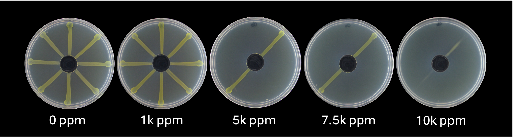
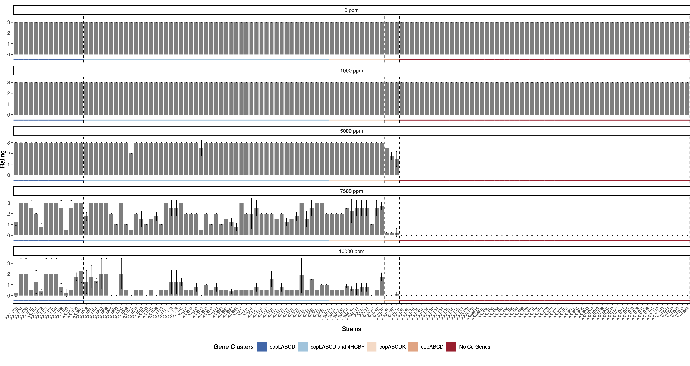
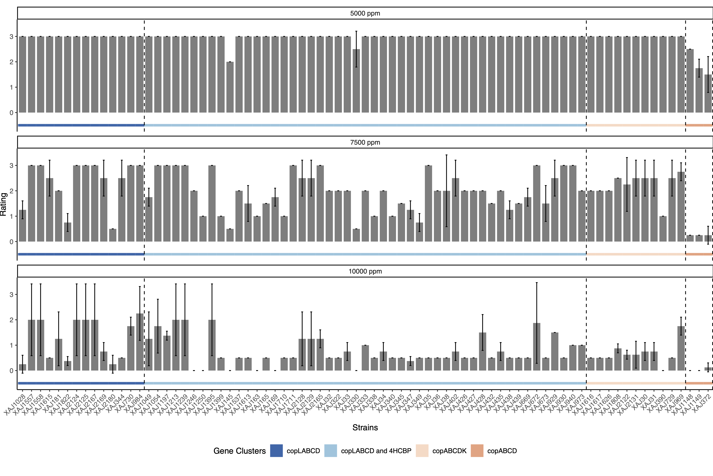
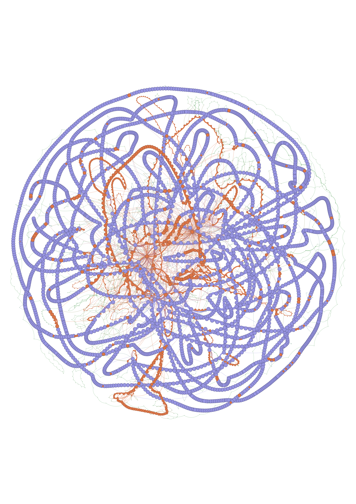
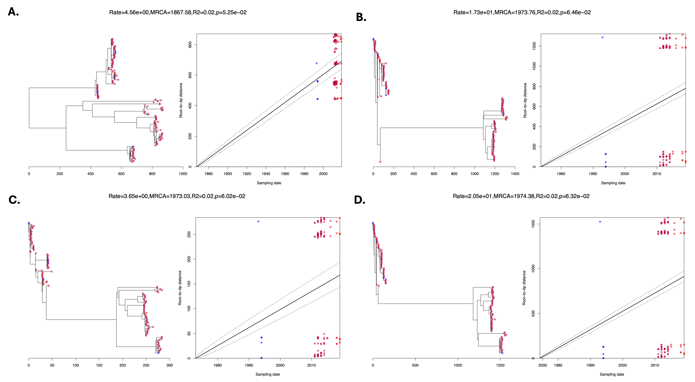
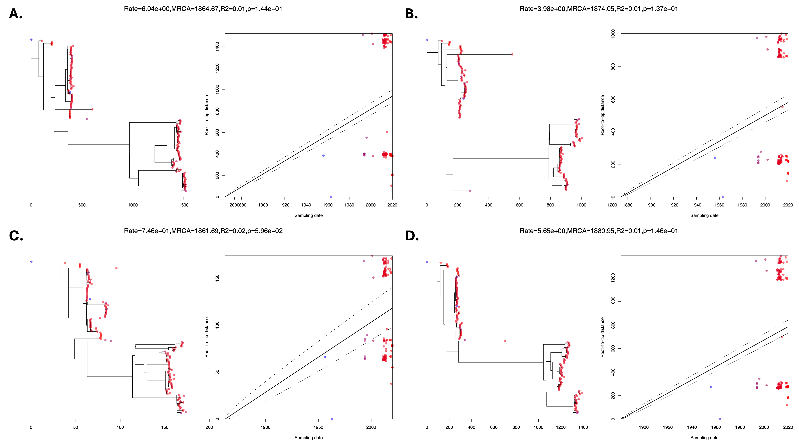

# Results {#Results}

## Read Processing

On average, 3.92 ± 0.44 G of raw data was generated for each strain (Table \@ref(tab:SeqRes)).

Table: (\#tab:SeqRes) Sequencing results from Novogene.

**Sample**|**Raw reads**|**Raw data**|**Effective(%)**|**Error(%)**|**Q20(%)**|**Q30(%)**|**GC(%)**
:-----:|:-----:|:-----:|:-----:|:-----:|:-----:|:-----:|:-----:
XAJ1028|25591934|3.8|99.8|0.03|97.84|94.32|65.61
XAJ1046|27128744|4.1|99.78|0.03|97.84|94.33|65.62
XAJ1048|22783072|3.4|99.78|0.02|97.91|94.49|65.53
XAJ1049|24548562|3.7|99.72|0.02|97.91|94.51|65.47
XAJ1054|21141570|3.2|99.4|0.03|97|93.14|65.35
XAJ1082|23517808|3.5|99.79|0.02|97.92|94.52|65.58
XAJ1086|22371990|3.4|99.79|0.02|97.96|94.58|65.6
XAJ1148|25554480|3.8|99.79|0.02|97.96|94.6|65.53
XAJ1149|24621852|3.7|99.81|0.02|97.86|94.42|65.59
XAJ1197|26704772|4|99.82|0.03|97.79|94.26|65.48
XAJ1213|22911558|3.4|99.83|0.02|97.88|94.38|65.46
XAJ1239|28284048|4.2|99.82|0.03|97.77|94.2|65.54
XAJ1246|24498244|3.7|99.82|0.02|97.92|94.46|65.49
XAJ1250|27743394|4.2|99.85|0.02|97.92|94.52|65.48
XAJ1395|23141436|3.5|99.78|0.02|98.2|95.06|65.49
XAJ1399|23736590|3.6|99.7|0.02|98.12|94.94|65.49
XAJ145|30305706|4.5|99.79|0.03|97.7|93.98|65.55
XAJ1498|22844534|3.4|99.73|0.02|98.11|94.9|65.54
XAJ1535|20554072|3.1|99.73|0.02|97.95|94.38|60.1
XAJ1537|28392148|4.3|99.75|0.02|98.14|94.97|65.47
XAJ1539|25641200|3.8|99.77|0.02|98.1|94.88|65.54
XAJ1551|24648774|3.7|99.76|0.02|98.17|95.03|65.63
XAJ1554|24667592|3.7|99.81|0.02|98.12|94.93|65.64
XAJ1556|26642296|4|99.77|0.02|98.11|94.91|65.53
XAJ1557|32063060|4.8|99.74|0.02|98.18|95.03|65.48
XAJ1558|22755570|3.4|99.79|0.02|98.16|94.97|65.5
XAJ1595|26746834|4|99.8|0.03|97.8|94.17|65.51
XAJ1606|22419850|3.4|99.83|0.02|97.95|94.57|65.48
XAJ1613|27831348|4.2|99.79|0.03|97.79|94.18|65.4
XAJ1614|27277774|4.1|99.8|0.03|97.75|94.1|65.53
XAJ1615|26327478|3.9|99.8|0.02|97.86|94.34|65.34
XAJ1616|30127594|4.5|99.82|0.03|97.77|94.12|65.55
XAJ1617|27929602|4.2|99.8|0.03|97.77|94.11|65.62
XAJ1626|26635082|4|99.78|0.03|97.81|94.21|65.52
XAJ163|27523144|4.1|99.81|0.02|97.88|94.37|65.5
XAJ165|29565610|4.4|99.83|0.03|97.69|93.98|65.5
XAJ169|29377416|4.4|99.83|0.03|97.82|94.24|65.5
XAJ1710|23142910|3.5|99.81|0.03|97.74|94.07|65.41
XAJ1711|25659456|3.8|99.81|0.03|97.75|94.09|65.36
XAJ1808|26157004|3.9|99.84|0.03|97.61|93.78|65.55
XAJ181|30304682|4.5|99.83|0.03|97.75|94.07|65.49
XAJ1822|25639610|3.8|99.84|0.03|97.65|93.89|65.51
XAJ1824|27202276|4.1|99.83|0.03|97.83|94.25|65.53
XAJ2122|29431940|4.4|99.77|0.02|97.89|94.38|65.52
XAJ2124|24947322|3.7|99.85|0.02|97.87|94.33|65.32
XAJ2125|21836920|3.3|99.79|0.03|97.77|94.18|65.32
XAJ2128|27026812|4.1|99.87|0.02|97.9|94.44|65.25
XAJ2129|28275218|4.2|99.86|0.02|97.91|94.48|65.29
XAJ2131|29505070|4.4|99.82|0.03|97.81|94.27|65.46
XAJ2165|16555726|2.5|99.74|0.02|97.9|94.48|65.35
XAJ2167|27266132|4.1|99.84|0.02|97.89|94.46|65.28
XAJ2169|26778130|4|99.85|0.02|97.98|94.59|64.07
XAJ2170|23357712|3.5|99.85|0.03|97.79|94.22|65.4
XAJ2178|25383038|3.8|99.82|0.02|97.9|94.48|65.4
XAJ2180|25701552|3.9|99.79|0.02|97.86|94.37|65.58
XAJ283A|31719184|4.8|99.75|0.03|97.76|94.14|65.55
XAJ283B|23850040|3.6|99.58|0.02|97.86|94.35|65.53
XAJ30|28549684|4.3|99.83|0.03|97.85|94.28|65.68
XAJ31|30944874|4.6|99.79|0.03|97.65|93.89|65.69
XAJ32|26826246|4|99.83|0.03|97.67|93.92|65.39
XAJ321|28989620|4.3|99.83|0.03|97.73|94.05|65.36
XAJ322|29391010|4.4|99.64|0.03|97.61|93.81|65.52
XAJ33|29806428|4.5|99.56|0.03|97.28|93.22|65.51
XAJ330|25695714|3.9|99.8|0.03|97.71|94.01|65.48
XAJ333|25529262|3.8|99.74|0.03|97.83|94.28|65.46
XAJ338|29804220|4.5|99.76|0.02|97.92|94.46|65.51
XAJ34|22366134|3.4|99.85|0.03|97.74|94.08|65.42
XAJ340|30453802|4.6|99.82|0.02|97.9|94.44|65.43
XAJ341|22967944|3.4|99.76|0.03|97.72|94.21|64.7
XAJ344|32172478|4.8|99.81|0.03|97.84|94.33|65.16
XAJ345|26215790|3.9|99.81|0.03|97.85|94.33|65.5
XAJ347|23904350|3.6|99.56|0.02|98.23|95.18|65.32
XAJ349|24222738|3.6|99.5|0.02|98.21|95.12|65.46
XAJ35|30751938|4.6|99.8|0.03|97.65|93.84|65.49
XAJ355|26167538|3.9|99.76|0.03|97.81|94.24|65.4
XAJ36|25042538|3.8|99.8|0.03|97.72|94.04|65.63
XAJ372|26460434|4|99.72|0.02|98.05|94.71|65.5
XAJ38|34529828|5.2|99.81|0.03|97.69|93.95|65.47
XAJ390|28702950|4.3|99.81|0.03|97.78|94.21|65.59
XAJ402|24876514|3.7|99.77|0.02|97.93|94.53|65.48
XAJ426|25297070|3.8|99.79|0.03|97.74|94.1|65.46
XAJ427|22565974|3.4|99.81|0.02|98.05|94.72|64.6
XAJ428|24115680|3.6|99.75|0.02|98.18|95.05|65.51
XAJ432|24746174|3.7|99.78|0.02|98.17|95.03|65.52
XAJ435|22312592|3.3|99.77|0.02|98.16|94.97|65.45
XAJ438|25001438|3.8|99.78|0.02|98.19|95.05|65.51
XAJ439|23152004|3.5|99.75|0.02|98.15|94.95|65.5
XAJ456|25371674|3.8|99.78|0.02|98.26|95.21|65.56
XAJ458|24367088|3.7|99.73|0.02|98.04|94.73|65.57
XAJ462|25507154|3.8|99.77|0.02|98.11|94.9|65.52
XAJ464|25831450|3.9|99.12|0.02|97.89|94.37|65.61
XAJ465|22375006|3.4|99.67|0.02|98.09|94.85|65.6
XAJ466|24006834|3.6|99.64|0.02|98.06|94.8|65.59
XAJ467|24139960|3.6|99.68|0.02|98.16|95.03|65.59
XAJ469|25378860|3.8|99.82|0.02|97.98|94.58|65.63
XAJ470|26132060|3.9|99.76|0.02|97.92|94.5|65.62
XAJ473|27096368|4.1|99.79|0.03|97.75|94.07|65.65
XAJ476|32787634|4.9|99.74|0.02|97.94|94.52|65.63
XAJ477|27245078|4.1|99.81|0.02|97.96|94.57|65.67
XAJ669|23070940|3.5|99.8|0.02|98.09|94.78|65.47
XAJ670|26035570|3.9|99.74|0.02|97.93|94.52|65.61
XAJ671|28669172|4.3|99.74|0.02|97.97|94.57|65.56
XAJ672|24008700|3.6|99.75|0.02|97.9|94.4|65.43
XAJ673|26955266|4|99.76|0.03|97.82|94.25|65.44
XAJ674|26455670|4|99.77|0.03|97.82|94.26|65.61
XAJ675|23235694|3.5|99.78|0.02|97.87|94.37|65.63
XAJ729|26190522|3.9|99.77|0.02|98.03|94.72|65.53
XAJ730|28142470|4.2|99.77|0.02|97.91|94.5|65.41
XAJ731|35859524|5.4|99.74|0.03|97.82|94.28|65.51
XAJ929|26992496|4|99.72|0.02|97.86|94.41|65.57
XAJ930|24434222|3.7|99.74|0.02|97.98|94.59|65.54
XAJ934|26225454|3.9|99.78|0.02|97.94|94.55|65.57
XAJ935|25156038|3.8|99.72|0.02|97.86|94.41|65.58
XAJ936|21308058|3.2|99.76|0.02|97.91|94.49|65.57
XAJ939|25645362|3.8|99.81|0.03|97.8|94.23|65.42
XAJ940|27863848|4.2|99.77|0.02|97.94|94.5|65.35
XAJ968|21680944|3.3|99.8|0.02|97.87|94.41|65.64
XAJ969|22272334|3.3|99.74|0.03|97.83|94.32|65.59
XAJ973|23804496|3.6|99.56|0.03|97.76|94.16|65.49
XAJ984|21104792|3.2|98.65|0.03|96.53|92.82|65.19
XAP1007|23944430|3.6|99.8|0.02|98.05|94.72|65.71
XAP1010|27496956|4.1|99.82|0.02|98.13|94.92|65.7
XAP1159|28628180|4.3|99.78|0.02|98.19|95.05|65.14
XAP1265|28189252|4.2|99.82|0.02|98.16|94.99|65.24
XAP1657|29414488|4.4|99.84|0.03|97.77|94.15|65.72
XAP1741|29420356|4.4|99.84|0.03|97.7|93.98|65.3
XAP2004|24706482|3.7|99.83|0.03|97.75|94.08|65.72
XAP2016|28494208|4.3|99.8|0.03|97.79|94.14|65.79
XAP2023|27413818|4.1|99.85|0.03|97.72|94.04|65.73
XAP2029|25694988|3.9|99.84|0.03|97.76|94.1|65.5
XAP2036|26720266|4|99.83|0.03|97.78|94.17|65.27
XAP2039|32014862|4.8|99.82|0.03|97.85|94.31|65.65
XAP2106|26342358|4|99.83|0.02|97.85|94.37|65.68
XAP2113|30149044|4.5|99.85|0.02|97.91|94.45|65.42
XAP2150|24668520|3.7|99.86|0.02|97.9|94.45|65.4
XAP664|26119486|3.9|99.83|0.02|97.98|94.62|65.48
XAP667|25615846|3.8|99.85|0.03|97.78|94.21|65.49
XAP880|23391520|3.5|99.81|0.03|97.78|94.23|65.69
XAP883|23847148|3.6|99.83|0.02|97.85|94.36|65.68
XAP948|24923122|3.7|99.77|0.02|98.14|94.92|65.05


## Genome Assembly and Annotation

The assembly pipeline was successful and generated contiguous, high-quality draft assemblies for the _Xaj_ and _Xap_ populations. The _Xaj_ assemblies were comprised of 61.4 ± 7.4 contigs with a length of 5.14 ± 0.07 Mb and an N50 of 167.1 Kb ± 27.7 Kb. The _Xaj_ PGAP annotations yielded 4,485.8 ± 79.1 genes and 4,217 ± 73 proteins. These assembly and annotation results are consistent with other _Xaj_ assemblies (n=32) that were included in Table S1 described in @assis2021. The results from CheckM run on the polished assemblies are found in Table \@ref(tab:CheckMres).

The _Xap_ assemblies were comprised of 34.9 ± 7 contigs with a length of 4.97 ± 0.02 Mb and an N50 317.6 ± 139.2 Kb. The _Xap_ PGAP annotations yielded 4,276.7 ± 22.6 genes and 3,987 ± 24.2 proteins. These assembly and annotation reports were consistent with other publicly available Xap genomic  [resources](https://www.ncbi.nlm.nih.gov/datasets/genome/?taxon=69929&annotated_only=true&refseq_annotation=true) (accessed August 24, 2024). The results from PGAP are found in \@ref(tab:PGAPres).

All the ANI reports indicated the isolates were `CONFIRMED` with `HIGH` confidence in the assigned taxonomy with $\geq 98.081%$ (Xaj) and $\geq 97.299%$ (Xap) identity to _Xanthomonas arboricola_ pv. _juglandis_ (GCA_001013475.1, ASM101347v1) in `ani_summary_table.tsv`. CheckM reports indicated $\geq 97.03%$ and 98.62% completeness and $\leq 1.32%$ and 1.87% contamination for the Xaj and Xap populations, respectively.


Overall, I'm satisfied with the genome assembly and annotation results of the _Xap_ and _Xaj_ populations. Our results are consistent with other published assemblies and will serve as a reliable resource for future studies. 

<div class="table-wrapper">
Table: (\#tab:CheckMres) Summarized _Xaj_ and _Xap_ CheckM (non-PGAP run) results. This data was generated by using [Summarize_CheckM.sh] (\@ref(CheckM-script))

**Pathovar**|**Ragout Reference**|**CheckM Completeness (%)**|**CheckM Contamination (%)**|**GC %**|**Genome size**|**Number of ambiguous bases (Ns)**|**Number of scaffolds**|**Number of contigs**|**Longest scaffold**|**Longest contig**|**N50 scaffolds**|**N50 contigs**|**Scaffold length**|**Mean Contig length**|**Number of predicted genes (CheckM)**|**Genome Size Mb (No Ns)**|**% Ns**
:-----:|:-----:|:-----:|:-----:|:-----:|:-----:|:-----:|:-----:|:-----:|:-----:|:-----:|:-----:|:-----:|:-----:|:-----:|:-----:|:-----:|:-----:
Xaj|IVIA1317|99.49|0.93|0.65|5,261,225|113,773.84|1.00|61.45|5,261,225.13|445,364.49|5,261,225.13|167,258.18|5,261,225.13|85,121.91|4,345.87|5.15|2.16
Xap|15\_088|99.70|0.71|0.66|5,090,341|110,063.00|1.00|34.95|5,090,341.15|694,894.65|5,090,341.15|317,644.50|5,090,341.15|148,701.74|4,187.15|4.98|2.16

</div>


<div class="table-wrapper">

Table: (\#tab:PGAPres) _Xaj_ and _Xap_ annotation results. This data was generated by using [Summarize_Genbank.py] (\@ref(Genbank-script)).

**Strain**|**Genes (total)**|**CDSs (total)**|**Genes (coding)**|**CDSs (with protein)**|**Genes (RNA)**|**tRNAs**|**ncRNAs**|**Pseudo Genes (total)**|**CDSs (without protein)**
:-----:|:-----:|:-----:|:-----:|:-----:|:-----:|:-----:|:-----:|:-----:|:-----:
Xaj|4485.2 ± 79|4383.3 ± 79.8|4217 ± 73.1|4217 ± 73.1|102.5 ± 3.9|54.7 ± 1.5|42 ± 2.9|166.3 ± 14.8|166.3 ± 14.8
Xap|4276.7 ± 22.7|4181.4 ± 22.2|3987.5 ± 24.3|3987.5 ± 24.3|95.3 ± 0.6|53.3 ± 0.6|36 ± 0|193.9 ± 7.1|193.9 ± 7.1

</div>


## _In Vitro_ Copper Sensitivity {#CuSensitivity}

We identified 77 _Xaj_ strains that were resistant to copper, the remaining _Xaj_ and all _Xap_ strains were sensitive. Resistance was characterized by growth at $\geq 5,000 ppm$ (\@ref(fig:CuPlates), \@ref(fig:CuAll), \@ref(fig:CuRes)). 

I identified five strains, XAJ321, XAJ341, XAJ939, XAJ1614, XAJ355, that did not align with the genomic data. These strains were all found to be resistant but did not encode copper resistance-related genes (see SECTION 4.4 Pangenome results). I removed these strains from the study and re-ran the pangenome and phylogenetic analyses. These updated runs have "XAJ_115" in the name. The results throughout this book will reflect these changes. 

```{r CuPlates, echo=FALSE, fig.cap="\\textit{In vitro} copper sensitivity. Pictured are strains $\\text{XAJ}1606$, $\\text{XAJ}355$, $\\text{XAP}880$, and $\\text{XAP}883$.", fig.align="center", out.width="80%", out.height="100%"}

```


```{r CuAll, echo=FALSE, fig.cap="\\textit{In vitro} copper sensitivity results for all strains ($\\text{n}=135$).", fig.align="center", out.width="100%", out.height="100%"}

```


```{r CuRes, echo=FALSE, fig.cap="\\textit{In vitro} copper sensitivity of the copper-resistant strains ($\\text{n}=77$).", fig.align="center", out.width="100%", out.height="100%"}

```


## Pangenome Analyses (NEED TO FINISH)
The pangenome analysis using `PPanGGoLiN` was successful. I will describe the results based on the respective runs: CA_XAJ_115 (n=115) and CA_XAJ_115_XAP (n=135), with more emphasis on the CA_XAJ_115 since that will be the data we use for the manuscript. The gene presence/absence data was used to identify genes related to copper resistance as well as Type III effectors. The pangenome graph was used to visualize the various partitions ('persistent', 'shell', and 'cloud'). 


### CA _Xaj_ (n=115)

The presence absence matrix file this data was acquired from is `matrix_Xaj_115.xlsx`.

#### Pangenome Partitions
A pangenome graph was generated with `Gephi` using the `pangenomeGraph.gexf` as the input file. Nodes represent gene families (clusters of homologous genes across the input genomes). Edges connect gene families that are genomic neighbors (i.e., their sequences are adjacent in at least one genome). The graph is partitioned into categories—persistent, shell, and cloud—based on how frequently gene families appear across genomes and their neighborhood relationships. This structure resembles a "subway map" of genomic diversity, allowing you to visualize the core and variable components of a species' pangenome. The 'persistent,' 'shell,' and 'cloud' genomes constitute 69.95%, 19.14%, and 10.91% of the pangenome, respectively (\@ref(fig:PGgraph)).

```{r PGgraph, echo=FALSE, fig.cap="Pangenome graph of the 115 CA \\textit{Xaj} strains. 'Persistent': purple; 'shell': orange; 'cloud': green.", fig.align="center", out.width="100%", out.height="100%"}

```


#### Copper Resistance-Related Genes

Various copper resistance-related genes have been characterized in _Xanthomonas_ and in _Xaj_. These genes include: _copL_, _copA_, _copB_, _copC_, _copD_, and _copK_ (@lee1994; cesbron2015; @marin2019; @assis2021). The _copA_ and _copC_ genes encode periplasmic copper-binding proteins, conferring partial copper resistance in _P. syringae_ (@marin2019). In _X. citri_, @richard2017 reported plasmid-bore copper resistance genes termed _copABCD_, however in _Xaj_ these genes are found on the chromosome (@lee1994; @giovanardi2016; @assis2021). In both copper-sensitive (Cu<sup>S</sup>) and copper-resistant (Cu<sup>R</sup>) _Xanthomonas_ strains, the chromosomal genes _cohL_, _cohA_, and _cohB_, involved in copper homeostasis, exhibit homology to cop resistance genes located on plasmids (@behlau2011; @behlau2016).

The `PPanGGoLiN` analysis successfully identified copper resistance-related genes as well as the copper homeostatsis genes. The genes associated with copper resistance are _copL_ family metal-binding regulatory protein, copper resistance system multicopper oxidase ( _copA_ ), copper resistance protein B ( _copB_ ), copper homeostasis periplasmic binding protein _copC_, copper homeostasis membrane protein _copD_, and _copK_ family periplasmic copper-binding protein. Each of these six genes are present in the 'shell' or 'cloud' partitions and while the respective _copL_, _copA_, _copB_ homeostasis genes are present in the 'persistent' genome and found in all 115 strains (\@ref(tab:CAxajCuGenes)). 

A total of 77 strains were found to encode copper resistance genes ( _copA_, _copB_, _copC_, _copD_, and _copK_) in various combinations and copy number. These same 77 strains were also characterized as Cu<sup>R</sup> based on the _in vitro_ sensitivity assay. 

<div class="table-wrapper">

Table: (\#tab:CAxajCuGenes) Genes associated with copper resistance and homeostasis. The annotations have been shortened, see `matrix_Xaj_115.xlsx` tab `Copper-resistance` for the full annotations. 

**Gene (PPanGGoLiN ID)**|**Partition**|**Annotation**|**No. strains**|**No. seqs**|**Avg seq per strain**
:-----:|:-----:|:-----:|:-----:|:-----:|:-----:
ACETXQ\_000680|cloud|*copA*|3|3|1
ACETXQ\_000681|cloud|*copB*|3|3|1
ACETXQ\_000677|cloud|*copC*|3|3|1
ACETXQ\_000676|cloud|*copD*|3|3|1
ACETZU\_002144|cloud|*copA*|11|11|1
ACETY7\_002282|cloud|*copB*|11|11|1
ACETY7\_002278|cloud|*copC*|11|11|1
ACETY7\_002277|cloud|*copD*|11|11|1
ACETY7\_002276|cloud|*copK*|11|11|1
ACETYR\_002169|shell|*copL*|59|107|1.81
ACETYY\_002111|shell|*copL*|63|111|1.76
ACETZG\_002299|shell|*copA*|63|111|1.76
ACETZG\_002300|shell|*copB*|63|111|1.76
ACETZG\_002301|shell|*copC*|63|111|1.76
ACETZG\_002302|shell|*copD*|63|111|1.76
ACETZG\_003906|persistent|*copL*|115|115|1
ACET0S\_003856|persistent|*copA*|115|115|1
ACETZG\_003908|persistent|*copB*|115|115|1
<div>


#### Type III Effectors

The presence/absence matrix (`matrix_Xaj_115.xlsx`) was used to identify type III effectors (T3Es) by searching for the term "tpye III secretion system effector" in the 'Annotations' column. I was able to identify 18 effectors using this method. After cross-referencing the tBLASTn & BLASTp results, I was able to identify 4 more that did not have "type III secretion system effector" in the annotation but were determined to be T3Es by Method 3 (\@ref(T3EMeth)).

Only two T3Es were identified in the presence/absence matrix, *XopR* and *XopAH*, that were not captured by Method 3 (**LINK METHOD 3 RESULTS TABLE**). 

- The XAJ283A *XopAH* gene (ACET0C_003701) was present in the raw `BLASTp` and `tBLASTn` outputs but exhibited ~28% identity with E-values of 5.11e-33 and 1.53e-36 to WP_011037263.1 (*XopAH*), respectively. I performed a web-based BLASTp with XAJ283A's *XopAH* gene ACET0C_003701 it yielded >99% ID to X. arboricola "XopAH/AvrB family type III secretion system effector" (WP_372159172.1, WP_080591327.1, and WP_258077835.1) and to Xaj "type III effector protein AvrB3" (AKU50911.1). The reason that this gene was not captured in the BLAST analyses is likely because the reference *XopAH* [WP_011037263.1](https://www.ncbi.nlm.nih.gov/protein/WP_011037263.1) is a *X. campestris* protein and exhibited too much sequence variation to the query *Xaj* sequences. 

- The XAJ283A *XopR* gene (ACET0C_000329) was present in the raw `BLASTp` and `tBLASTn` outputs but exhibited ~37% and ~44% identity with E-values of 2.12e-60 and 4.89e-36 to WP_011260681.1 (*XopR*), respectively. I performed a web-based BLASTp with XAJ283A's *XopR* gene ACET0C_000329 it yielded 100% and 99.76 % idenetity to *X. arboricola* "type III secretion system effector protein *XopR*" (WP_104538897.1) and to the *X. arboricola* pv. *corylina* "type III secretion system effector protein *XopR*" (WIX26666.1), respectively. The reason this gene was not captured in the BLAST analyses is likely because the reference *XopR* sequence ([WP_011260681.1](https://www.ncbi.nlm.nih.gov/protein/WP_011260681.1)) is a MULTISPECIES *Xanthomonas* *XopR* sequence and exhibited too much sequence variation to the query *Xaj* sequences.


The respective protein sequences for XopR and XopAH in strain Xaj283A were subjected to a web-based BLASTp search and the results yielded (\@ref(tab:PangT3E)). 

<div class="table-wrapper">

Table: (\#tab:PangT3E) Type III effectors identified from the PPanGGoLiN presence/absence matrix (`matrix_Xaj_115.xlsx`). 

**Gene (PPanGGoLiN ID)**|**Partition**|**T3E**|**No. strains**|**No. sequences**|**Avg sequences per strain**|**Captured by Method 3?**|**Type**
:-----:|:-----:|:-----:|:-----:|:-----:|:-----:|:-----:|:-----:
ACETYW\_002316|cloud|*AvrBs1*|2|2|1|Yes|Variable
ACETYW\_002318|cloud|*XopH1*|2|2|1|Yes|Variable
ACETZ0\_003513|cloud|*XopG2*|14|14|1|Yes|Variable
ACETZG\_004545|persistent|*AvrBs2*|115|115|1|Yes|Core
ACETZV\_000338|persistent|*XopR*|115|115|1|No|Core
ACETZG\_001290|persistent|*XopAV1*|115|115|1|Yes|Core
ACETZG\_001291|persistent|*XopAV2*|115|115|1|Yes|Core
ACETZG\_000577|persistent|*XopF1*|115|115|1|Yes|Core
ACETZG\_003328|persistent|*XopK*|115|115|1|Yes|Core
ACETZG\_003062|persistent|*XopK*|115|115|1|Yes|Core
ACETZG\_001289|persistent|*XopQ*|115|115|1|Yes|Core
ACETZG\_003209|persistent|*XopAW*|112|112|1|Yes|Variable
ACETZG\_000745|persistent|*XopV*|115|115|1|Yes|Core
ACETZG\_000656|persistent|*XopX*|115|115|1|Yes|Core
ACETZG\_002419|persistent|*XopZ*|115|115|1|Yes|Core
ACETZG\_003349|persistent|*XopL*|115|115|1|Yes|Core
ACETZG\_000602|persistent|*XopM*|115|115|1|Yes|Core
ACETZG\_001505|persistent|*XopAZ*|115|115|1|Yes|Core
ACETZG\_001286|shell|*XopG3*|110|110|1|Yes|Variable
ACETY6\_003877|shell|*XopAI*|48|48|1|Yes|Variable
ACETYR\_003597|shell|*XopAH*|78|79|1.01|No|Variable
ACETZG\_002185|shell|*XopE4*|53|53|1|Yes|Variable
<div>

#### Modules, Spots, and RGPs (**LEFT OFF HERE!!!**)


**Modules**

- Definition: Modules in PPanGGOLiN are conserved groups of genes, typically from the variable (shell and cloud) genome, that tend to co-occur and are co-localized across multiple genomes in the pangenome. These are often hypothesized to represent functional units that are gained or lost together.

- How They’re Generated: Modules are predicted using the panModule method, which analyzes patterns of gene co-occurrence and genomic neighborhood within RGPs. The process involves identifying clusters of genes that consistently appear together in the variable regions of the pangenome.

**Spots**

- Definition: Spots, or Spots of Insertion, are groups of RGPs from different genomes that share conserved flanking persistent genes, indicating a common insertion site in the pangenome. They represent hotspots of genomic variability.
  
- How They’re Generated: After RGPs are identified, the spot command groups them into Spots based on shared genomic context (persistent gene borders). This clustering reflects where RGPs tend to integrate across the pangenome.

**RGPs (Regions of Genomic Plasticity)**

- Definition: RGPs are genomic regions in individual genomes that consist of genes from the shell and cloud partitions (i.e., non-persistent genes). These regions are typically associated with horizontal gene transfer (HGT) and often correspond to Genomic Islands (GIs).

- How They’re Generated: The panRGP method identifies RGPs by scanning each genome and detecting clusters of consecutive shell or cloud genes, using a score-based algorithm to define boundaries. Persistent genes flanking these regions help delineate them.

**Interconnection**

- Modules, RGPs, and Spots are interconnected: Modules are often subsets of genes within RGPs, and Spots group RGPs across genomes. The --spot_modules option ties these together by associating Modules with specific Spots and RGPs, enabling a deeper understanding of how conserved gene clusters relate to variable genomic regions.

- Purpose: Together, these features allow PPanGGOLiN to depict microbial diversity by partitioning the pangenome into persistent, shell, and cloud components, then analyzing the variable regions for patterns of conservation and plasticity.
    
## Phylogenetic Analyses (NEED TO FINISH)

```{r CAXAJR2T, echo=FALSE, fig.cap="Root-to-tip regression analysis on CA\\_XAJ using BactDating. \\textbf{A.} ClonalFrameML. \\textbf{B.} Gubbins. \\textbf{C.} ClonalFrameML and IQtree. \\textbf{D.} ClonalFrameML and Gubbins", fig.align="center", out.width="100%", out.height="100%"}
  
```


```{r CAXAJNCBI24R2T, echo=FALSE, fig.cap="Root-to-tip regression analysis on CA\\_XAJ\\_NCBI\\_24 using BactDating. \\textbf{A.} ClonalFrameML. \\textbf{B.} Gubbins. \\textbf{C.} ClonalFrameML and IQtree. \\textbf{D.} ClonalFrameML and Gubbins", fig.align="center", out.width="100%", out.height="100%"}

```
