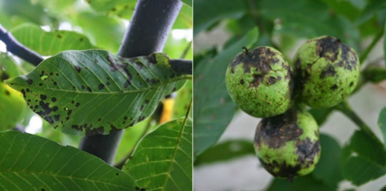

# Preface

This is a digital laboratory notebook that I used for my postdoctoral research in the lab of Dr. James E. Adaskaveg at University of California, Riverside.

Enjoy.

```{r walnutblight, echo=FALSE, fig.cap="Walnut blight symptoms. Credit: James E. Adaskaveg and Helga Förster", fig.align="center"}

```

<!-- If you need PDF output, uncomment bookdown::pdf_book above in YAML. You will need a LaTeX installation, e.g., https://yihui.name/tinytex/ -->
